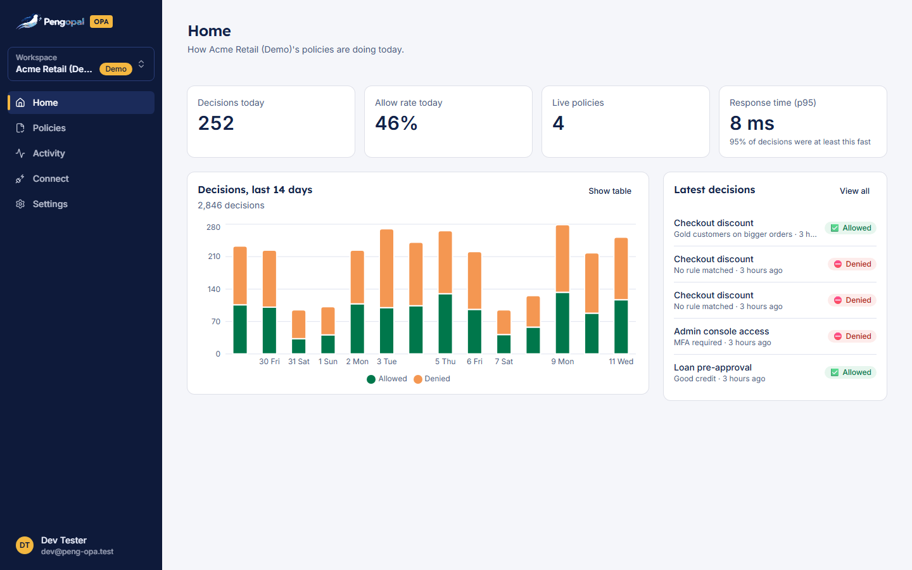
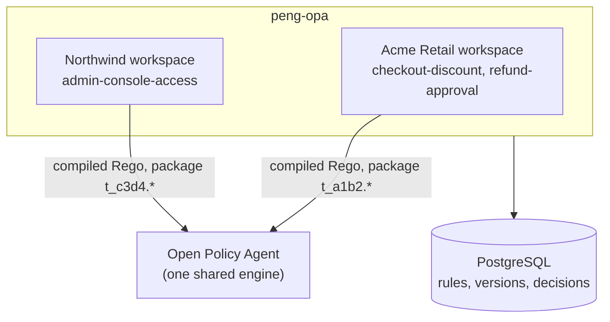
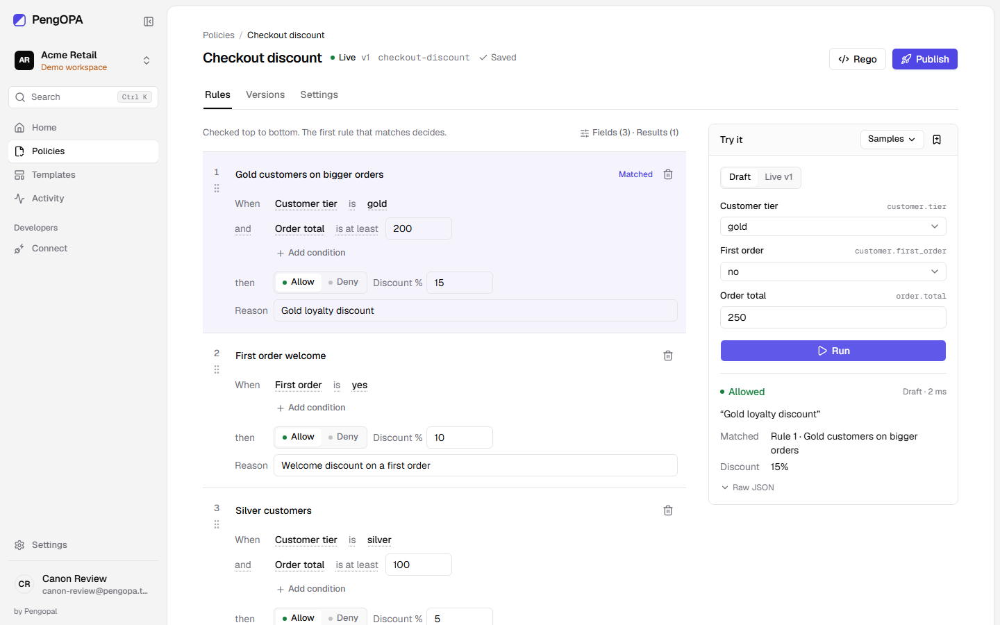
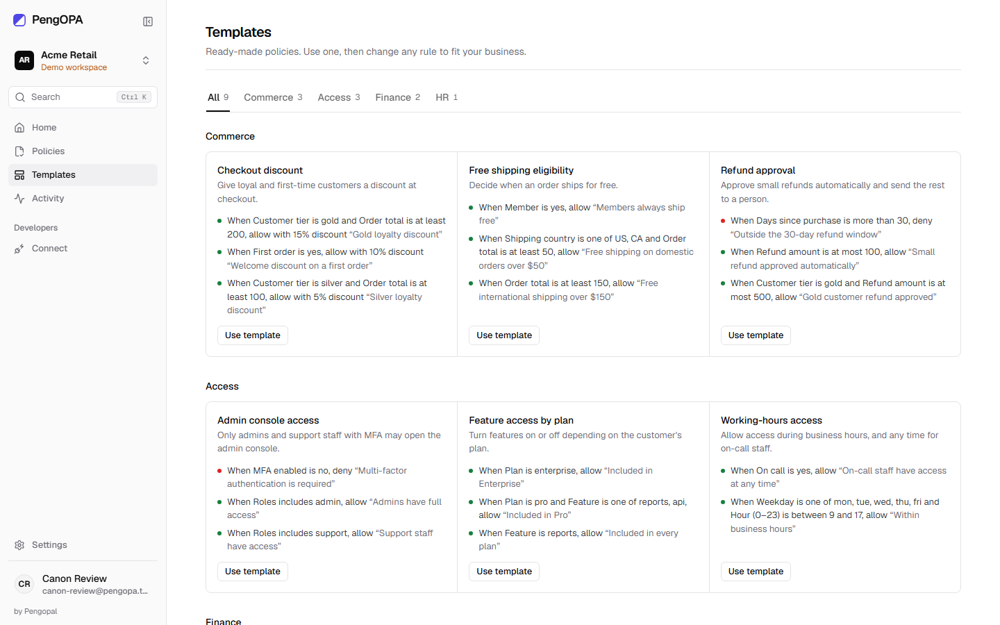
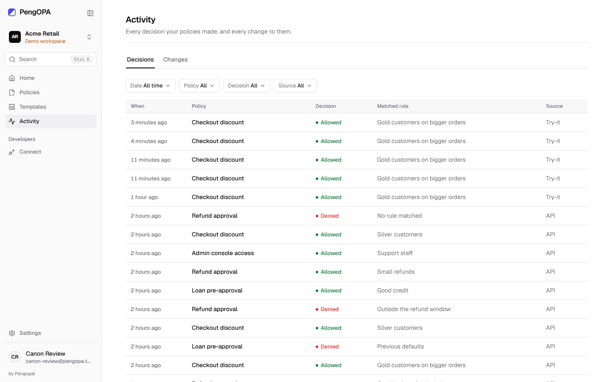
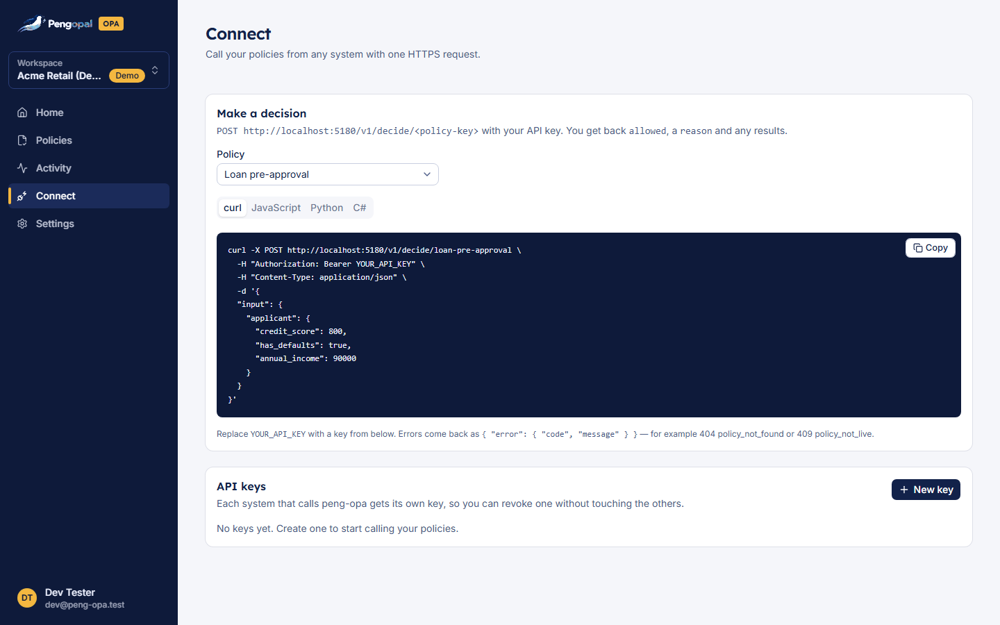
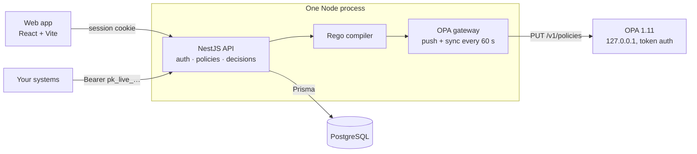

<div align="center">

<picture>
  <source media="(prefers-color-scheme: dark)" srcset="docs/images/pengopa-logo-dark.svg">
  
</picture>

**Business rules and access policies, decided in milliseconds — a multi-tenant policy manager built on Open Policy Agent.**

<sub><b>Built with</b></sub><br>
[](https://www.typescriptlang.org)
[](https://nodejs.org)
[](https://nestjs.com)
[](https://react.dev)
[](https://vite.dev)
[](https://ui.shadcn.com)
[](https://tailwindcss.com)
[](https://www.openpolicyagent.org)
[](https://www.postgresql.org)
[](https://www.prisma.io)
[](https://www.better-auth.com)
[](https://pnpm.io)
[](https://vitest.dev)
[](https://playwright.dev)

</div>



## The problem

Every business runs on rules: who gets a discount, which refunds go through without a manager, who may open the admin
console. They usually live as `if` statements scattered across services, and changing one means a ticket, a code
change and a deploy.

[Open Policy Agent](https://www.openpolicyagent.org) solves the engine side of this — fast, tested, auditable
decisions — but it speaks Rego, and the people who own the rules are ops and compliance staff, not engineers.

peng-opa puts a plain-language editor in front of OPA:

- **Ops staff** build rules as sentences ("When customer tier is gold and order total is at least 200 → allow,
  15% discount"), test them, and publish.
- **Engineers** call one HTTPS endpoint and get a decision back. They never write Rego.



Each workspace is a tenant. Its policies, history, members and API keys are invisible to every other workspace.

## Features

### Rules as sentences

Each policy is a list of rules, checked top to bottom; the first one that matches decides. A rule is conditions
("Order total **is at least** 200"), an Allow or Deny, a reason, and optional results such as a discount percentage.
Field types (text, number, yes/no, date, list) decide which operators are offered.



### Try it, then publish

The **Try it** panel runs any input against the draft or the live version and shows which rule matched and why.
Saved samples make re-testing one click. **Publish** shows exactly what changed since the live version; every
publish is a numbered version you can compare, restore as a draft, or roll back to.

### Start from a template

Nine ready-made policies across Commerce, Access, Finance and HR — checkout discount, refund approval, admin console
access, loan pre-approval and more — each with sample inputs to try.



### See every decision

**Home** shows decisions per day, the allow rate, live policies and response time. **Activity** is the full decision
log, filterable by policy, outcome, source and date; any decision can be replayed in the Try it panel. A **Changes** tab
records who published, paused or rolled back what.



### Connect your systems

API keys are created per workspace, shown once, and revocable. **Connect** gives copy-ready samples in curl,
JavaScript, Python and C#.



### Built for demos

One click creates **Acme Retail**: four live policies, two weeks of decision history and simulated live traffic that
switches itself off after ten minutes. **Reset** puts it back the way it started. With `DEMO_PUBLIC=true`, the sign-in
page offers a shared, read-only demo for website visitors.

### Teams

- **Roles:** Owner (everything), Editor (policies, publish, test) and Viewer (read-only plus Try it).
- **Invites:** sent by email through [Resend](https://resend.com) (or any SMTP server) when configured; otherwise
  shown as a link to copy.
- **Sign-in:** email and password, plus optional "Continue with Google".

## How it keeps workspaces apart

Every request is scoped to one workspace, and the scoping is enforced below the application code.

| What someone tries | What happens |
|---|---|
| Sends another workspace's id in `x-workspace-id` | 403 — membership is checked on every request |
| Calls `/v1/decide` with a workspace id in the body | Ignored — the workspace comes only from the API key |
| Uses an API key on another workspace's policy key | 404 `policy_not_found` |
| A query in the API forgets its workspace filter | The Prisma extension adds it; a query with no workspace context throws |
| Reaches OPA directly | OPA listens on 127.0.0.1 only and rejects calls without the app's token |
| One workspace floods the decision API | Rate-limited per workspace (`429 rate_limited`); others are unaffected |

The isolation tests live in [`apps/server/test/workspace-scope.e2e.spec.ts`](apps/server/test/workspace-scope.e2e.spec.ts)
and the decide, API-key and members suites next to it.

## Architecture



There is no Docker. The NestJS process serves the API and the built web app, and starts the bundled OPA binary as a
supervised child process (restarted with backoff if it crashes). Rules are stored as structured JSON, compiled to Rego
on publish, and pushed to OPA; a sync loop re-pushes anything OPA is missing after a restart. Decisions are written to
an audit log asynchronously, so logging never slows a decision down. The full design is in the
[design spec](docs/superpowers/specs/2026-11-11-peng-opa-design.md).

## Try it in five minutes

You need Node 22, pnpm 10 and PostgreSQL 14 or later.

```bash
pnpm install
```

```bash
cp .env.example .env
```

Set `DATABASE_URL` in `.env` and create the database, then:

```bash
pnpm --filter server db:deploy
```

```bash
pnpm dev
```

Open <http://localhost:5180>, create an account, and choose **Explore the demo workspace**. Full setup, configuration
and production steps are in [docs/SETUP.md](docs/SETUP.md); a walkthrough for showing it to someone is in the
[demo script](docs/demo-script.md).

## Calling the decision API

```http
POST /v1/decide/checkout-discount
Authorization: Bearer pk_live_…
Content-Type: application/json

{ "input": { "customer": { "tier": "gold" }, "order": { "total": 620 } } }
```

```json
{
  "allowed": true,
  "reason": "Gold loyalty discount",
  "outcomes": { "discount": 15 },
  "rule": "Gold customers on bigger orders",
  "policy": { "key": "checkout-discount", "version": 3 },
  "decisionId": "dec_…"
}
```

Batches, error codes and retry advice are in [Connect your app](docs/guides/connect-your-app.md).

## Documentation

- [Setting up locally](docs/SETUP.md): requirements, configuration, tests and running in production
- [Deploying to Railway](docs/DEPLOY.md): the hosted setup behind opa.pengopal.com
- Guides: [Writing policies](docs/guides/writing-policies.md) · [Connect your app](docs/guides/connect-your-app.md)
- [Demo script](docs/demo-script.md): a ten-minute walkthrough of the demo workspace
- [Known issues](docs/known-issues.md): limits of v1 and findings deferred from review
- [Design spec](docs/superpowers/specs/2026-11-11-peng-opa-design.md) and
  [build log](docs/superpowers/build-log-2026-11-11.md) (every decision made while building v1)

## Contributing

Contributions are welcome. Read [CONTRIBUTING.md](CONTRIBUTING.md) before opening a pull request — it covers the
repository layout, how to run each test suite, and the rules every change follows (tests first, workspace isolation,
plain-language UI copy).

- **Bugs and ideas:** open an issue with steps to reproduce, or the problem you want solved.
- **Security problems:** do not open a public issue; email the Pengopal team instead.

## Licence

Copyright © 2026 Pengopal Technologies. All rights reserved.
